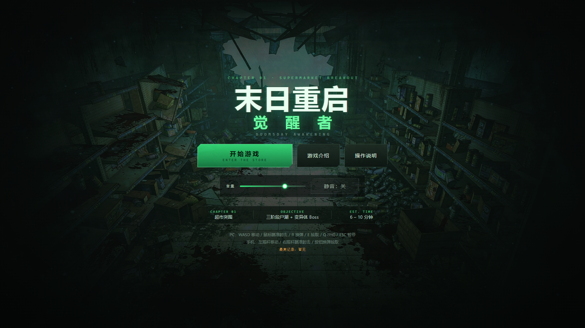
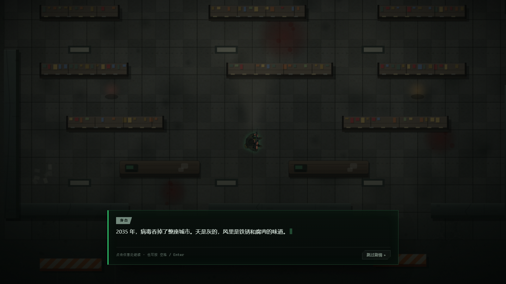
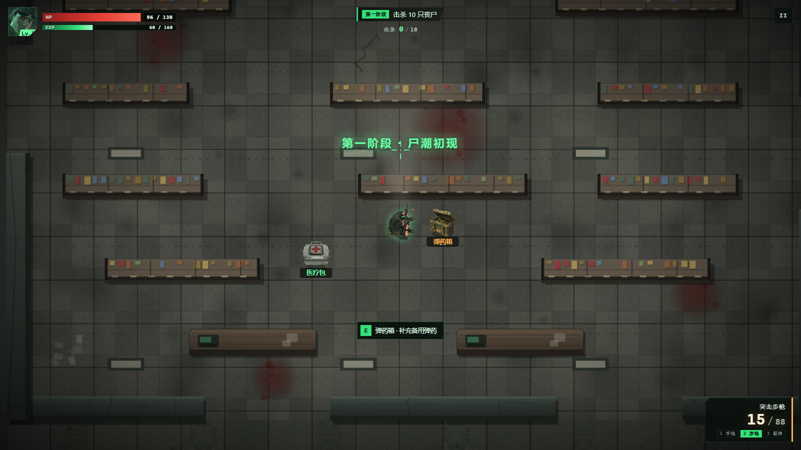
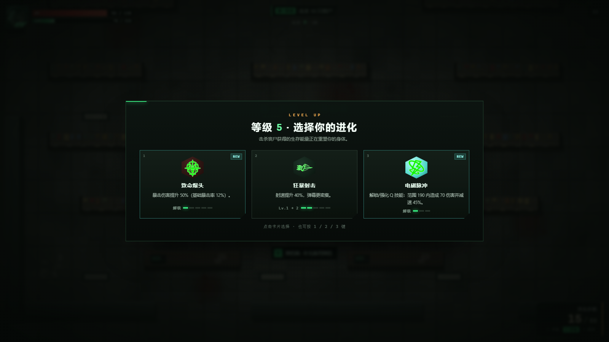
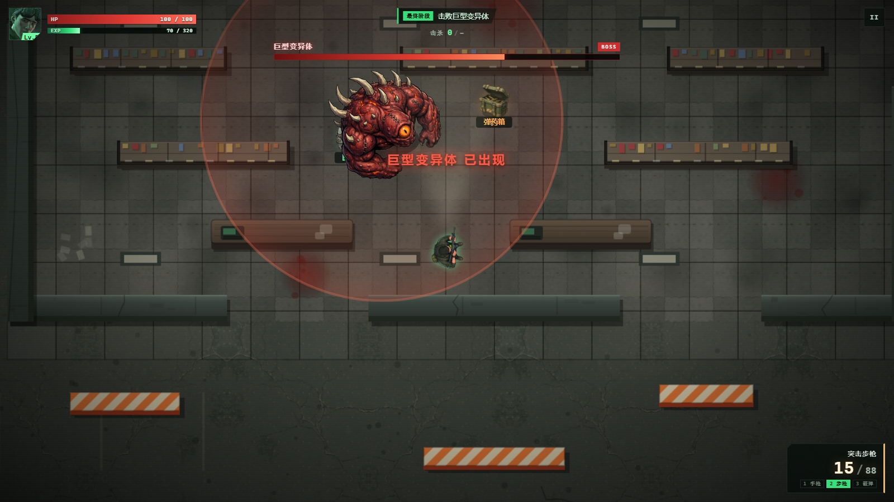
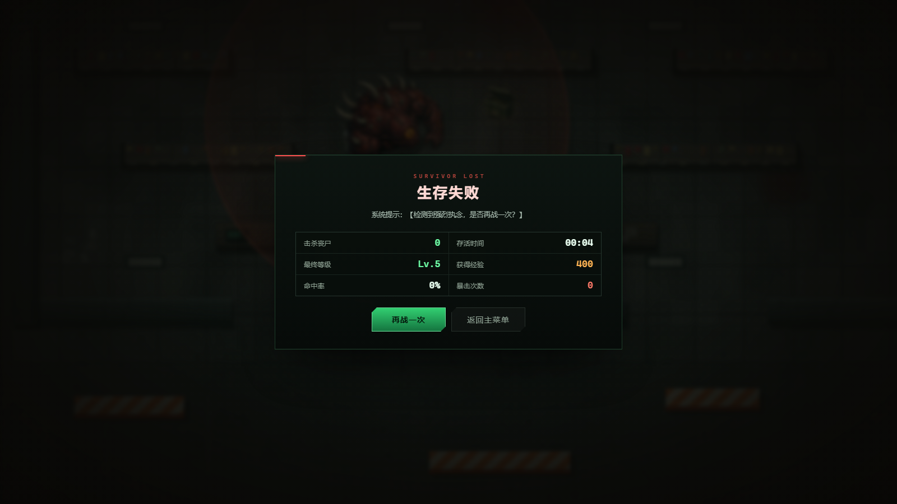
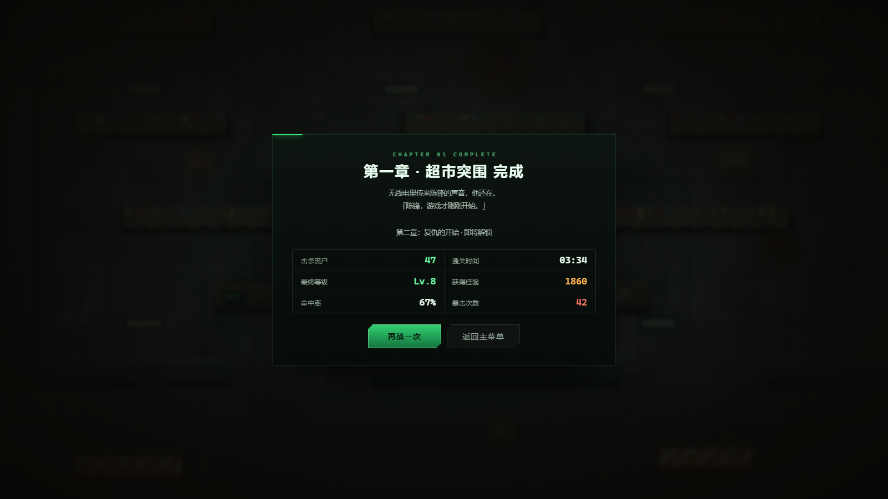
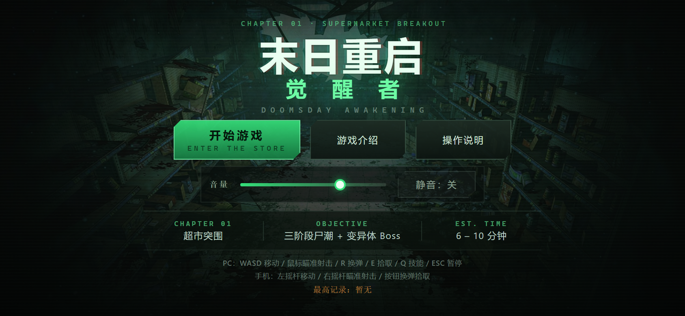
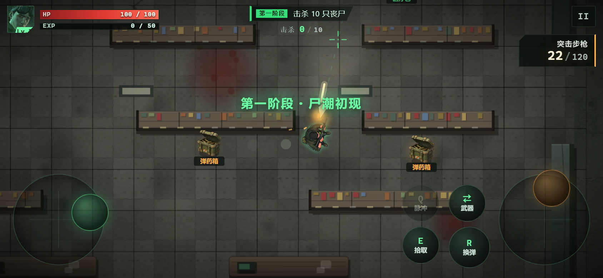

# 末日重启：觉醒者 · Doomsday Awakening

> 一款可以直接在浏览器里玩通的 HTML5 末世丧尸射击 Demo。
> 原生 HTML + CSS + JavaScript ES Modules + Canvas 2D，无框架、无外部素材依赖，**PC 键鼠 + 手机触屏双摇杆** 双端可玩。



---

## 一、游戏介绍

| 项目 | 内容 |
| --- | --- |
| 类型 | 末世生存 / 俯视角丧尸射击 / 轻度 RPG 成长 |
| 平台 | PC 浏览器（Chrome / Edge）、手机与平板浏览器（横屏） |
| 引擎 | 原生 Canvas 2D + requestAnimationFrame，无第三方库 |
| 时长 | 单局约 6 – 10 分钟（三阶段尸潮 + Boss 战 + 结算） |
| 存档 | LocalStorage 保存音量设置与最佳战绩 |

主角**林夜**在一次超市搜刮行动中被队友**陈锋**关门抛弃，濒死之际觉醒「末日生存系统」。
你需要杀穿三波尸潮、击败巨型变异体，并在结尾的无线电里向背叛者宣战。

### 游戏截图

| 剧情演出 | 战斗 |
| --- | --- |
|  |  |

| 升级三选一 | Boss 战 |
| --- | --- |
|  |  |

| 失败结算 | 胜利结算 |
| --- | --- |
|  |  |

| 手机主菜单（844×390） | 手机双摇杆战斗 |
| --- | --- |
|  |  |

---

## 二、故事背景（原创）

2035 年，未知病毒摧毁人类文明。城市沦为丧尸猎场，幸存者只能在废墟中抢夺最后的物资。

林夜跟随队伍进入废弃超市，尸潮突袭时，队长陈锋关上了安全门——

> 「别怪我，末世里只能牺牲弱者。」

就在丧尸扑上来的那一刻，视野里浮出一行荧光绿的字：

> 【末日生存系统已激活】
> 【新手任务：击杀 20 只丧尸】

杀丧尸 → 得经验 → 升级进化 → 强化武器 → 杀穿超市 → 去找陈锋算账。
第一章结束在无线电里的那句：「陈锋，游戏才刚刚开始。」

> 全部剧情、角色、文本均为本项目原创，未引用任何现有小说、短剧或商业作品。

---

## 三、操作说明

### PC（键盘 + 鼠标）

| 操作 | 按键 |
| --- | --- |
| 移动 | `W` `A` `S` `D`（支持同时按下，斜向已归一化） |
| 瞄准 | 鼠标移动（玩家朝向始终跟随鼠标） |
| 射击 | 按住鼠标左键连续射击 |
| 换弹 | `R`（打空会自动换弹） |
| 拾取物资 | `E`（靠近物资时屏幕下方出现提示） |
| 电磁脉冲 | `Q`（升级时选择「电磁脉冲」后解锁） |
| 切换武器 | `1` 手枪 / `2` 步枪 / `3` 霰弹枪（仅已获得的武器） |
| 暂停 | `ESC` |
| 剧情推进 / 技能选择 | `空格` / `Enter` 推进剧情；`1` `2` `3` 选择技能 |

### 手机 / 平板（触屏，建议横屏）

| 操作 | 位置 |
| --- | --- |
| 移动 | 左下角**左摇杆**，拖动即可八方向移动，松手自动归零 |
| 瞄准 + 射击 | 右下角**右摇杆**，拖动方向即射击方向，按住即连续射击，松手停火 |
| 换弹 / 拾取 / 脉冲 / 换武器 | 摇杆旁边的四个圆形按钮 |
| 暂停 | 右上角 `II` |

* 支持多指同时操作：左手移动 + 右手射击互不干扰（基于 Pointer Events + pointerId 管理）。
* 竖屏进入时会提示旋转设备（可在提示里选择「仍然继续」）。
* 切到后台会自动暂停，回到前台显示「继续游戏」。
* 屏幕已处理 safe-area 安全区与地址栏收缩导致的尺寸变化。

---

## 四、核心玩法

1. **三阶段尸潮**（击杀目标 10 / 15 / 20）
   - 第一阶段：普通丧尸
   - 第二阶段：普通 + 疾跑丧尸
   - 第三阶段：普通 + 疾跑 + 毒液丧尸
   - 三阶段完成后进入 **Boss 阶段**：巨型变异体（1800 HP，震地预警 + 直线冲撞 + 50% 血量狂暴）
2. **成长**：击杀获得经验，升级暂停游戏并弹出 **3 选 1 技能**，技能真实改变战斗数值。
3. **物资**：弹药箱 / 医疗包 / 经验晶体 / 武器箱，地图固定刷新 + 丧尸概率掉落。
4. **战斗反馈**：枪口火焰、弹壳、曳光弹、命中血雾、伤害数字、暴击金色数字、屏幕震动、Boss 血条、震地预警圈。
5. **结算**：胜利/失败都会给出击杀数、等级、时间、经验、命中率、暴击次数，并写入最佳战绩。

### 武器数据（集中管理在 `js/data/weapons.js`）

| 武器 | 弹匣 | 伤害 | 射速 | 换弹 | 特点 |
| --- | --- | --- | --- | --- | --- |
| 制式手枪 | 12 | 25 | 3 发/秒 | 1.2s | 精准、省弹 |
| 突击步枪（初始） | 30 | 18 | 8 发/秒 | 1.5s | 高射速，清群主力 |
| 战术霰弹枪 | 6 | 12 × 5 弹丸 | 1 发/秒 | 2.0s | 近距离爆发 |

### 技能（`js/data/skills.js`，随机三选一，可叠加升级）

| 技能 | 效果 | 最大等级 |
| --- | --- | --- |
| 狂暴射击 | 射速 +20% / 级 | 5 |
| 强化弹药 | 子弹伤害 +25% / 级 | 5 |
| 致命爆头 | 暴击伤害 +50% / 级（基础暴击率 12%） | 5 |
| 生命强化 | 最大生命 +30 并立即回复 30 / 级 | 5 |
| 快速换弹 | 换弹时间 -30%（乘算）/ 级 | 5 |
| 电磁脉冲 | 解锁/强化 `Q`：范围伤害 + 减速 45% | 3 |

---

## 五、技术栈与架构

* **HTML5 + CSS3**：所有 UI 使用 DOM 层（文字清晰、响应式布局、safe-area），游戏世界使用 Canvas。
* **JavaScript ES Modules**：34 个 JS 模块，职责分离，无打包工具、无框架。
* **Canvas 2D**：全部美术程序化绘制（角色、丧尸、Boss、货架、汽车、路障、特效）。
* **离屏静态地图层**：整张 2400×1800 地图只在开局绘制一次，每帧只 blit 可视区域。
* **对象池**：子弹 / 毒液弹 / 粒子 / 伤害数字全部池化，超出上限覆盖最旧对象。
* **LocalStorage**：设置 + 最佳战绩（隐私模式下静默降级）。
* **Web Audio**：实时合成 20+ 种音效（枪声、丧尸、拾取、升级、Boss、胜负），无音频文件。
* **Pointer Events**：双虚拟摇杆 + 多点触控（pointerId 隔离），与 PC 输入统一进 `InputManager`。

### 关键设计

| 问题 | 方案 |
| --- | --- |
| 手机画布模糊 / 错位 | `canvas.width = cssW × DPR`，渲染变换使用 `zoom × dpr`，坐标转换统一走 `Camera.screenToWorld` |
| 丧尸穿墙 / 卡墙 | 分轴碰撞解算 + 射线试探绕行 + 1.1s 卡住检测；跨建筑内外时先走「门口」路点 |
| 子弹穿墙 | 线段扫掠检测（Liang-Barsky）；货架/收银台/路障属于低矮掩体，子弹可越过 |
| 暂停 / 升级 / 结算仍刷怪 | 状态机：只有 `playing` 才推进世界逻辑 |
| 切后台回来瞬移 | `deltaTime` 上限 50ms + 自动暂停 |
| 对象无限增长 | 所有实体与特效均有硬上限（见 `config.LIMITS`） |

---

## 六、项目目录

```
doomsday-awakening/
├── index.html                 # 唯一入口页面（Canvas + 全部 UI 覆盖层）
├── package.json               # 仅用于本地脚本（type: module），无运行时依赖
├── README.md
├── TEST_REPORT.md              # 功能测试报告
├── css/
│   ├── style.css              # 基础布局 / 变量 / 画面后期特效
│   ├── game.css               # HUD / 触屏摇杆 / 移动端适配
│   └── ui.css                 # 菜单 / 剧情 / 升级 / 暂停 / 结算
├── js/
│   ├── main.js                # 入口：资源、存档、异常捕获、全局事件
│   ├── config.js              # 全局配置与数值入口（世界、色板、上限、波次）
│   ├── game.js                # 总装配 + 状态机 + 流程编排
│   ├── core/
│   │   ├── GameLoop.js        # rAF 主循环、dt 钳制、FPS 统计
│   │   ├── InputManager.js    # 统一输入（键鼠 + 触屏摇杆注入）
│   │   ├── Camera.js          # 跟随 / 边界 / 缩放 / 震屏 / 坐标转换
│   │   ├── Collision.js       # 圆-矩形、线段扫掠、滑动解算
│   │   ├── AssetManager.js    # 资源接口（图片加载失败回退程序化绘制）
│   │   └── MathUtils.js       # 数学 / 随机工具
│   ├── data/
│   │   ├── weapons.js         # 武器数据表
│   │   ├── zombies.js         # 敌人数据表
│   │   ├── skills.js          # 技能数据表 + EMP 曲线
│   │   ├── story.js           # 原创剧情脚本
│   │   └── mapData.js         # 废弃超市地图（墙体/货架/车辆/刷新点/门口）
│   ├── entities/
│   │   ├── Player.js          # 移动 / 射击 / 换弹 / 受伤 / 背包 / 数值聚合
│   │   ├── Zombie.js          # 三种丧尸 AI（追击 / 远程 / 绕行 / 卡住检测）
│   │   ├── Boss.js            # 变异体（前摇重击 / 震地 / 冲撞 / 狂暴）
│   │   ├── Bullet.js          # 子弹与毒液弹（池化 + 扫掠碰撞）
│   │   └── Loot.js            # 物资与掉落
│   ├── systems/
│   │   ├── CombatSystem.js    # 射击 / 命中 / 伤害 / EMP / Boss 震地
│   │   ├── SpawnSystem.js     # 波次推进 / 出生点选择 / Boss 出场
│   │   ├── LevelSystem.js     # 经验曲线与升级队列
│   │   ├── SkillSystem.js     # 技能等级 → 战斗系数
│   │   ├── ParticleSystem.js  # 粒子 / 伤害数字（池化）
│   │   ├── AudioSystem.js     # Web Audio 程序化音效
│   │   └── SaveSystem.js      # LocalStorage 存档
│   ├── render/
│   │   └── Renderer.js        # 静态地图层 + 动态实体 + 世界 UI + 准星
│   └── ui/
│       ├── HUD.js             # 血条 / 经验 / 弹药 / 波次 / Boss 血条 / 提示
│       ├── Menu.js            # 主菜单 / 介绍 / 操作说明 / 音量
│       ├── Dialog.js          # 逐字剧情 / 跳过
│       ├── UpgradePanel.js    # 技能三选一
│       ├── PausePanel.js      # 暂停
│       ├── ResultPanel.js     # 胜利 / 失败结算
│       └── TouchControls.js   # 双虚拟摇杆 + 触屏按钮
├── assets/
│   └── images/favicon.svg     # 站点图标（其余美术全部程序化绘制）
├── tools/                     # 测试与截图工具（不参与游戏运行）
│   ├── check-syntax.mjs       # 逐文件语法检查
│   ├── dom-stub.mjs           # Node 环境 DOM/Canvas 打桩
│   ├── headless-test.mjs      # 无浏览器逻辑回归测试（94 条断言）
│   ├── browser-test.mjs       # 真实 Chrome 端到端测试（34 条断言）
│   ├── sim-debug.mjs          # 平衡性模拟（脚本玩家跑波次）
│   ├── boss-probe.mjs         # Boss 战耗时/伤害探针
│   ├── probe.mjs              # 瞄准→命中→受伤定点探针
│   ├── responsive-check.mjs   # 多分辨率布局检查（58 条断言）
│   ├── session-check.mjs      # 真实浏览器连续实战验证
│   ├── import-sprite.mjs      # AI 白底图 → 透明精灵（抠图/水印/锚点裁切）
│   ├── rotate-check.mjs       # 旋转体检：0/90/180/270 对照图
│   ├── capture-shots.mjs      # 自动生成 docs 截图
│   └── shot.mjs               # 任意区域截图小工具
└── docs/
    ├── screenshot-01..10.png  # 真实浏览器渲染截图
    └── test-logs/             # 三层测试的原始输出
```

> `assets/audio` 目录预留给将来接入真实音频；当前音效全部由 `AudioSystem` 实时合成，因此没有体积负担，也不会出现「音频 404」。

---

## 七、如何运行

ES Modules 必须通过 HTTP 访问，**不要直接双击 `index.html`**。

### 方式 1：Python（推荐，Windows/macOS 自带或易安装）

```bash
cd doomsday-awakening
python -m http.server 8000
```

浏览器打开 <http://localhost:8000>

### 方式 2：Node.js

```bash
npx serve .          # 或 npx http-server -p 8000
```

### 方式 3：VS Code Live Server

右键 `index.html` → Open with Live Server。

### 手机同局域网试玩

```bash
python -m http.server 8000 --bind 0.0.0.0
```

手机浏览器访问 `http://<电脑局域网 IP>:8000`（Windows 需允许防火墙入站），并横屏游玩。

---

## 八、已完成功能

- [x] 主菜单（Logo、开始、介绍、操作说明、音量、静音、最佳战绩）
- [x] 逐字剧情（可点击/空格继续、可跳过、系统提示音效、Boss 与结尾剧情）
- [x] 玩家移动（归一化斜向）、鼠标瞄准、连续射击、换弹、受伤无敌、死亡
- [x] 三把武器（数据集中管理、切换、备弹、独立射击特效与手感）
- [x] 四种敌人（普通/疾跑/毒液/Boss），绕行、门口寻路、卡住自愈、攻击前摇
- [x] 完整战斗循环：子弹、扫掠碰撞、暴击、击退、掉落、伤害数字、震屏
- [x] 经验与升级（50/100/160/230…）、升级暂停、三选一、连续升级队列
- [x] 六个技能（含可主动释放的 EMP，全部真实改变数值）
- [x] 四种物资 + 靠近提示 + `E`/按钮拾取 + 拾取反馈
- [x] 三阶段尸潮 + Boss 阶段 + 任务/波次/击杀 HUD + Boss 血条
- [x] 胜利 / 失败结算 + 战绩存档 + 再战 / 返回菜单
- [x] 暂停（ESC / 按钮）、切后台自动暂停、恢复提示
- [x] 程序化美术（地图、角色、丧尸、Boss、武器、物资、特效）
- [x] 程序化音效 + 音量/静音（用户交互后才初始化音频）
- [x] 手机双虚拟摇杆 + 多点触控 + 四个触屏按钮 + 安全区适配
- [x] 响应式 Canvas（DPR 高清、窗口/旋转/地址栏变化自适应）
- [x] 对象上限与清理（子弹/粒子/伤害数字/丧尸/物资）

### 已知限制

1. **美术是混合的**：角色（主角/3 丧尸/Boss）、地面贴图、汽车、4 种物资图标、HUD 头像、主菜单背景都已换成 AI 生成素材；**货架、收银台、路障、墙体**改为程序化精修（AI 出这类俯视长条物件视角不对，改用伪高度 + 金属框 + 价签等细节提升质感，见 `docs/ART_ASSETS.md` 5.55 节）。
   - 接入方式：图片优先、程序化兜底（`AssetManager.IMAGE_MANIFEST` 登记即用，删除登记即还原）。
   - AI 生成内容说明：主角立绘由豆包生成后裁切/抠图，仅用于课程 Demo，未商用。
2. **真机未实测**：手机适配通过 Chrome 设备模拟（844×390、DPR 2、真实触摸事件）验证，未在真实 iPhone / Android 上跑过；iOS 的横屏锁定与安全区表现需真机复核。
3. **存档只保存设置与最佳战绩**，不保存单局进度（浏览器关闭即结束）。
4. **Boss 只有一种**（第一章），技能与武器数量按 Demo 范围设计。
5. 移动端为性能考虑会降低粒子上限（420 → 240）。

---

## 八点五、放上作品集？

**在线试玩：<https://doomsday-awakening-69778.app.workbuddy.host/portfolio/embed.html>**（发布版，已验证 22 个资源全部加载、0 报错）


`portfolio/` 目录已经准备好一整套接入材料：

| 文件 | 用途 |
| --- | --- |
| `portfolio/embed.html` | 独立试玩页：海报 → 点击开始 → 全屏 / 重开 / 新窗口 |
| `portfolio/snippet.html` | 最小 iframe 片段，复制进你的页面即可 |
| `portfolio/case-study.md` | 项目介绍、技术亮点、量化结果、复盘、英文简介 |
| `portfolio/README.md` | 三种接入方式 + 部署注意 + 上线自检清单 |

规则只有两条：**整个目录一起部署**（相对路径）、**父容器给 iframe 一个 16:9 的高度**。

## 九、后续扩展方向

1. 第二章「复仇的开始」：城市街区地图、陈锋作为人形 Boss（会使用掩体与手雷）。
2. 武器改装系统（弹匣/枪管/瞄具）与稀有度掉落。
3. 更多技能分支（召唤无人机、燃烧弹、时间减速）与技能树存档。
4. 精灵图替换：接入 `assets/images` 后只需在 `AssetManager` 清单登记，无需改渲染逻辑。
5. 音效资源化：`assets/audio` + `AssetManager.loadAudio` 已在接口层预留。
6. 移动端进一步优化：离屏地图分块、WebGL 渲染、低功耗模式。
7. 数据统计与排行榜（本地或轻量后端）。

---

## 九点五、自己替换美术？先看清单

> 主角精灵已经接入（`assets/images/characters/player.png`，56 世界单位，锚点=躯干中心）。
> 转换工具：`node tools/import-sprite.mjs <原图> <输出.png> --anchor=0.515,0.53 --clearBR=0.72,0.90`


如果需要把手绘美术接进来（替换当前的程序化绘制），尺寸、命名、图集规范、要改的函数都在
**[docs/ART_ASSETS.md](docs/ART_ASSETS.md)**（P0 最小包 18 张图 → P1 场景补充 → P2 可选），
豆包/即梦的**可直接复制的出图提示词**在 **[docs/ART_PROMPTS.md](docs/ART_PROMPTS.md)**。

## 十、测试

```bash
node tools/check-syntax.mjs     # 语法检查（35 个文件）
node tools/headless-test.mjs    # 逻辑回归（94 条断言，含暴击/毒池/触屏摇杆/多点触控）
```

真实浏览器端到端测试（需先启动服务器与 headless Chrome）：

```bash
python -m http.server 8000
chrome --headless=new --remote-debugging-port=9222 --window-size=1440,900 about:blank
node tools/browser-test.mjs     # 34 条断言 + 自动截图
node tools/responsive-check.mjs # 58 条多分辨率布局断言
node tools/session-check.mjs    # 真实浏览器 38 秒连续实战（需 9222 调试端口）
```

合计 **186 条断言**（35 语法 + 94 逻辑 + 34 浏览器 + 58 布局）全部通过。
详细结果见 [TEST_REPORT.md](TEST_REPORT.md)，原始日志见 `docs/test-logs/`。
